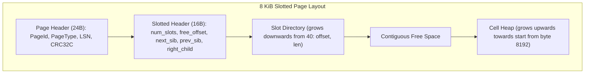
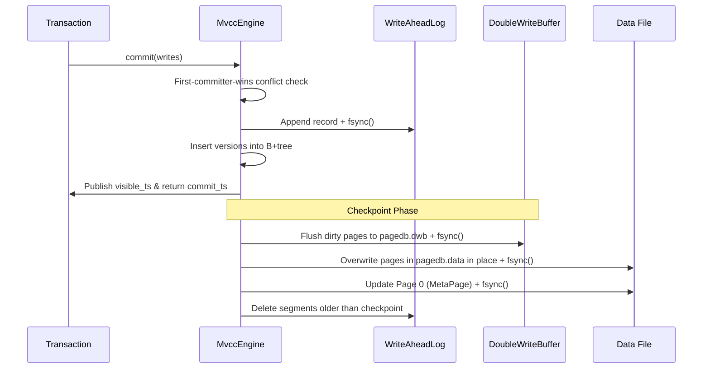

# pagedb
[](https://github.com/hiroshi-os/pagedb/actions/workflows/ci.yml)

A high-performance B+tree storage engine written in 100% safe Rust featuring MVCC snapshot isolation, WAL redo recovery, and double-write buffer protection against torn pages. Designed from first principles to provide predictable tail latencies and crash resilience under adversarial power loss and kill -9 terminations.

## Benchmark Results
Measured on AMD Ryzen 5 7530U (6 Cores, 12 Threads), 24 GB RAM, Windows 11 on NVMe SSD (NTFS). All figures are verified empirical measurements from `bench/RESULTS.md`. See [RESULTS.md](bench/RESULTS.md) for full hardware metadata and command lines.

| Category / Benchmark | Configuration | Metric | Measured Result |
|---|---|---|---|
| **Crash Invariance** | 300 `kill -9` terminations | Lost committed txns / Partial visible | **0 lost / 0 partial** (2,812 txns checked) |
| **Torn Page Recovery** | 20 sector tear injections | Successful DWB repairs | **20 / 20 repaired** (0 CRC leaks) |
| **Recovery Negative Control** | `--features unsafe-skip-dwb --tear` | Corruptions detected | **10 corruptions detected** (control proven) |
| **Isolation Invariance** | 16 accts, 8 transfer + 4 reader threads | Bank balance conservation | **100% conserved** (>50 scans checked) |
| **Lost Update Invariance** | 8 threads × 1,000 increments | Final counter value | **8,000** (0 lost updates) |
| **Lost Update Negative Control** | `--features unsafe-no-conflict-check` | Anomaly detection | **Anomaly observed (< 8,000)** |
| **YCSB Workload A** | 50% Read / 50% Update (8 threads) | Throughput / p99 Latency | **1,447.4 ops/s** / **31.74 ms** |
| **YCSB Workload B** | 95% Read / 5% Update (8 threads) | Throughput / p99 Latency | **24,414.1 ops/s** / **6.17 ms** |
| **YCSB Workload C** | 100% Read-only (8 threads) | Throughput / p99 Latency | **339,933.6 ops/s** / **0.10 ms** |
| **YCSB Workload E** | 95% Scan (100k) / 5% Insert (8 threads)| Throughput / p99 Latency | **744.1 ops/s** / **22.05 ms** |
| **Commit Latency** | `sync = Always` (1 thread, Workload A) | p50 / p99 Latency | **0.02 ms** / **1.28 ms** |
| **Crash Recovery Time** | Replay & Tree Open | Total duration | **224 ms** |

## Quickstart

### 1. Build
```bash
cargo build --release
```

### 2. Interactive CLI REPL
```bash
./target/release/pagedb-cli target/demo_db
```
Example REPL session:
```text
pagedb> BEGIN
OK: transaction started at snapshot
pagedb> PUT user_1 Alice
OK
pagedb> PUT user_2 Bob
OK
pagedb> COMMIT
OK: committed at ts 1
pagedb> SCAN
Total: 2 entries
  user_1 => Alice
  user_2 => Bob
pagedb> CHECK
Tree Invariants Passed: TreeStats { height: 1, leaf_pages: 1, internal_pages: 0, total_keys: 2, fill_factor: 0.04 }
pagedb> EXIT
```

### 3. Run Automated Tests & Crash Harnesses
```bash
# Run all unit, model, and concurrency tests
cargo test --release

# Run adversarial kill -9 crash test suite (30 runs)
cargo run --release --bin crashtest -- --runs 30 --seed 42

# Run torn-page injection crash test suite (20 runs)
cargo run --release --bin crashtest -- --tear --runs 20 --seed 42
```

## Design

### Page Layout
Each 8 KiB page features a 24-byte common header and a slotted directory architecture:


### Commit & Checkpoint Sequence


### MVCC Key Encoding
User keys are mapped to internal keys by appending inverted commit timestamps:
$$\text{internal\_key} = \text{user\_key} \parallel (\text{u64::MAX} - \text{commit\_ts})$$
Because timestamps are stored inverted in big-endian ordering, the latest version of any key sorts first in B+tree scans, enabling $O(\log N)$ point lookups for current data.

### Why No-Steal plus a Logical Redo WAL
Under the buffer pool's **No-Steal** policy, dirty pages modified by active transactions are never evicted to disk prior to a checkpoint. Consequently:
- Uncommitted writes never touch the data file.
- Recovery is **redo-only**: crash recovery only needs to replay committed records from the WAL after the checkpoint LSN without requiring undo logging or rollback logic.

### Double-Write Buffer (DWB)
File systems that perform partial sector writes during an abrupt power loss produce torn pages. The DWB safeguards database integrity by staging all dirty pages and their checksums into `pagedb.dwb` before touching `pagedb.data`. On startup, if any page in `pagedb.data` suffered a torn write, the DWB restores the consistent pages before the B+tree is accessed.

### Concurrency & Isolation Matrix

| Anomaly | Read Committed | Snapshot Isolation (`pagedb`) | Serializable |
|---|:---:|:---:|:---:|
| **Dirty Read** | Prevented | Prevented | Prevented |
| **Non-repeatable Read** | Allowed | Prevented | Prevented |
| **Lost Update** | Allowed | Prevented (First-Committer-Wins) | Prevented |
| **Write Skew** | Allowed | **Allowed** | Prevented |

### Comparison: B+Tree (`pagedb`) vs LSM-Tree (`lsmstore`)
- **Read Latency & Tail Latency**: `pagedb`'s B+tree ensures $O(\log N)$ point lookups bounded strictly by tree height (height 3 for 100,000 keys) and avoids multi-level bloom filter checks and compaction read amplification seen in LSMs.
- **Write Amplification & In-Place Updates**: Unlike LSM trees which batch writes sequentially into memtables and incur background write amplification during compactions, `pagedb` buffers writes in transactions and updates slotted pages in place during checkpoints.
- **Range Scans**: In `pagedb`, range scans traverse sequential leaf sibling chains directly without merging iterators across multiple sorted run levels.

## Honesty / Limitations
- **Snapshot Isolation, not Serializable**: `pagedb` implements Snapshot Isolation. Write skew anomalies (e.g. concurrent doctors on call) can occur and are documented as expected behavior under SI.
- **Global Commit Mutex**: Concurrency utilizes a global commit lock and B+tree lock; latch crabbing and fine-grained page-level latching are not implemented in the MVP.
- **No-Steal Working Set Limits**: Because dirty pages cannot be evicted before a checkpoint, transaction write sets and dirty working memory are bounded by available buffer pool frames.
- **No Page Merge on Delete**: MVP deletes mark cells or remove slots without leaf merge or node redistribution; deleted page space is reclaimed during vacuuming or node defragmentation, but the data file does not shrink.
- **Durability Scope**: Durability relies on OS `fsync` calls on NTFS and ext4 filesystems; power-loss verification was simulated via `SIGKILL` (`kill -9`) and programmatic sector tear injection rather than hardware pull-plug testing.
- **Single Process**: `pagedb` is an embedded single-process storage engine without distributed replication.
